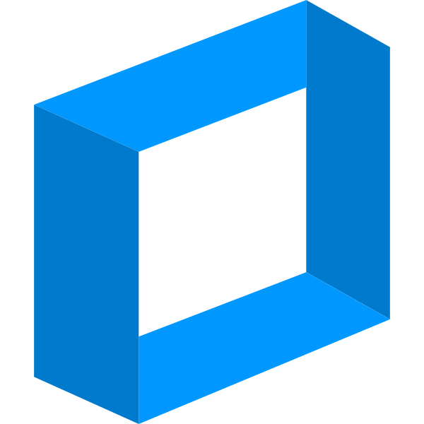

<p align="center">
  
</p>

<h1 align="center">Frame Server</h1>

<p align="center">Terminal sessions and AI agent connectors for Rust application hosts.</p>

<p align="center">
  <a href="https://crates.io/crates/frame-terminal"></a>
  <a href="https://crates.io/crates/frame-agent-connectors"></a>
  <a href="https://github.com/poziel/frame-server/actions/workflows/rust.yml"></a>
  <a href="LICENSE"></a>
  <a href="https://github.dev/poziel/frame-server"></a>
</p>

Frame Server provides the execution layer behind [Frame](https://github.com/poziel/frame)
applications. Embed its Rust libraries in your own host, or use the agent
package's JSONL executable. Each package works independently of Frame's UI,
Tauri, and Electron.

Your application controls credentials, authorization, process ownership, and
lifecycle. Constructing an engine or connector starts no shell or provider.

## Choose a package

| Package                                                                     | Use it to                                                                                                        | Documentation                                                                                 |
| --------------------------------------------------------------------------- | ---------------------------------------------------------------------------------------------------------------- | --------------------------------------------------------------------------------------------- |
| [`frame-terminal`](https://crates.io/crates/frame-terminal)                 | Discover shells and manage PTY sessions, input/output, resizing, and cleanup                                     | [Quick start](packages/terminal-rust/README.md) · [API](https://docs.rs/frame-terminal)       |
| [`frame-agent-connectors`](https://crates.io/crates/frame-agent-connectors) | Connect Codex, Claude, Gemini, GitHub Copilot, and OpenCode through a shared Rust runtime or JSONL host protocol | [Quick start](packages/agents-rust/README.md) · [API](https://docs.rs/frame-agent-connectors) |

## Install from crates.io

Both libraries are published at **0.1.1**. Add only the capabilities your host needs:

```toml
[dependencies]
frame-terminal = "0.1.1"
frame-agent-connectors = "0.1.1"
```

Cargo downloads public crates without authentication. For example, list the
shells available on the current machine without starting a terminal:

```rust
use frame_terminal::Terminals;

fn main() {
    for profile in Terminals::default().profiles() {
        println!("{}: {}", profile.id, profile.path.display());
    }
}
```

For agents, see the [embedded runtime example](packages/agents-rust/README.md#embed-the-runtime)
and the provider-specific setup requirements in that package's README.

## Download from GitHub Releases

The [v0.1.1 release](https://github.com/poziel/frame-server/releases/tag/v0.1.1)
provides the same version as downloadable Cargo source packages:

- [frame-terminal-0.1.1.crate](https://github.com/poziel/frame-server/releases/download/v0.1.1/frame-terminal-0.1.1.crate)
- [frame-agent-connectors-0.1.1.crate](https://github.com/poziel/frame-server/releases/download/v0.1.1/frame-agent-connectors-0.1.1.crate)

These archives contain Rust source, rather than prebuilt applications. To use
an archive locally, download it into your application's directory and extract it:

```sh
tar -xf frame-terminal-0.1.1.crate
```

Then use the extracted directory as a Cargo path dependency:

```toml
[dependencies]
frame-terminal = { path = "frame-terminal-0.1.1" }
```

The agent archive works the same way. Cargo still resolves third-party
dependencies when building. Pinned Git dependencies are also supported; see
[release and distribution details](docs/releases.md).

## Integrate with your host

- The terminal library supplies the PTY engine; your host assigns trusted owner
  identities and connects terminal output to its renderer or transport.
- Agent connectors translate provider events into a shared model. Your host
  supplies executables, authentication, working directories, and approval UI.
- Frame owns framework-specific bridges, including its Tauri terminal plugin.
  This repository contains the host-independent engines.

See [architecture](docs/architecture.md), [host examples](examples/README.md),
and the [Frame documentation](https://frame.poziel.dev/) for integration context.

## Develop locally

Install Rust/Cargo and Python 3.10+ for the offline agent test fixtures. From the
repository root:

```sh
cargo test --workspace --locked
python -m unittest discover -s packages/agents-rust/python -p 'test_*.py'
cargo package --workspace --locked
```

Run the examples without starting a shell or contacting a provider:

```sh
cargo run -p frame-terminal --example profiles
cargo run -p frame-agent-connectors --example embedded
```

For local consumer development, use a Cargo `path` dependency pointing to the
package under `packages/terminal-rust` or `packages/agents-rust`.

[Contributing](CONTRIBUTING.md) · [Security](SECURITY.md) ·
[Changelog](CHANGELOG.md) · [MIT license](LICENSE)
